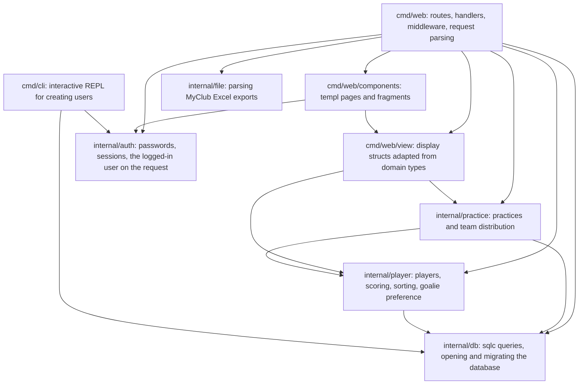

# Architecture

The layers, the rules between them, and why. It holds only what stays true when files and functions are renamed. For what exists, run `go doc ./internal/practice` (and the same for the other packages). For the stack and why it was chosen, see [`spec/constitution.md`](spec/constitution.md). For the entities and how they are stored, see [`spec/domain-model.md`](spec/domain-model.md).

If this file disagrees with the code, the code is right and this file is the bug. It is updated before a branch merges to `main` when a layer, a rule, a package's job or a decision changed (step 7 of the constitution).

## Layers

Left out of the diagram: `cmd/web/analytics`, a web-only helper that carries the PostHog key on the request context for `cmd/web` and `components`. It holds no domain logic and no rule depends on it.

Check it by hand with `go list -f '{{join .Imports "\n"}}' ./internal/practice | grep go-tiimit` (and the same for the other packages).

## Rules

1. Arrows point down only. An `internal/` package never imports `net/http`, `view`, `components` or anything in `cmd/`. `view` and `components` never import `db`.
2. Split by one question: does this need an `http.Request`, a template or a view type? If not, it is a rule and belongs in an `internal/` package. If so, it stays in `cmd/web`.
3. Handlers convert domain types to `view` types; templates never render domain or `db` types directly.
4. A rule takes the narrowest input it can use and returns plain data, so it can be table-tested without a database (as `practice.Distribute` is).
5. A rule that must not race lives in SQL, not in Go. Toggling a vest is one `UPDATE` that flips the stored value, not a read followed by a write, so quick taps cannot undo each other (legacy/practices.md, slice 2).
6. Pages that show player data require login (`requireAuth`); `authMiddleware` only puts the user on the request context.

## Where does new code go

| You are adding | It goes in |
|---|---|
| A route, or anything read from the request | `cmd/web`, registered in `main.go`, handler in that resource's `handlers_*.go` |
| A page or fragment | a `.templ` file in `cmd/web/components` |
| A shape only a page needs (formatted values, which row is being edited) | `cmd/web/view` |
| A rule about players: scores, sorting, goalie preference, imports into players | `internal/player` |
| A rule about practices or how teams are distributed | `internal/practice` |
| Reading a MyClub export | `internal/file` |
| Anything about passwords or sessions | `internal/auth` |
| A table or column | a Goose migration in `sql/schema` (timestamp-prefixed), then regenerate |
| A query | `sql/queries`, then regenerate |
| A user-management task an admin runs | `cmd/cli` (until I17, deprecating the CLI, is decided) |
| Anything about running on the Pi | `deploy.sh`, `.deploy.conf.example`, with the steps a person runs in `docs/deployment-guide.md` |

## Conventions

- An htmx request gets an HTML fragment back, and a redirect is sent as `HX-Redirect`; a plain form request gets a full page or a normal redirect.
- Errors shown to the coach go through the error banner component; the log line says which operation failed and on which ids.
- Generated files are never edited by hand. `CLAUDE.md` says how to tell them apart.
- Comments in production code (everything except `*_test.go`): a doc comment's first sentence starts with the name and says what it returns or does, so it works alone in `go doc`. Add more sentences only for a rule or a reason the code cannot show. Leave out spec ids (the tests carry the link to scenarios), history (that is git log), and the body retold in prose. Readers are LLM sessions first and Human-PM second: plain full sentences.
- Tests: pure rules have table tests beside them in `internal/`. HTTP-level acceptance tests for milestone scenarios live in `cmd/web/*_test.go` (from milestone 00), building the app on a fresh SQLite file and driving the router. A test's comment carries its scenario number (`// 01/S3: ...`).

## Not moved yet

Known places where the code does not follow the rules above yet. Fix one when a milestone touches that code anyway; delete its line in the same change.

- Handlers call `db` queries directly for most reads and writes, and creating a practice (attendance rows → players → distribution → one transaction) runs inside `handleCreatePractice` rather than in `internal/practice`.

## Decisions and why

- **Two teams, everywhere.** The database check, the queries and the UI all assume exactly two. Changing it is a milestone of its own, not a parameter.
- **Sessions in the database, not JWT.** One server, one SQLite file: a session row is simpler to reason about and can be revoked on logout.
- **Users only from the CLI.** No sign-up page means no public way to create an account. Revisit with I16/I17.
- **Packages are named for the concept** (`practice`, `player`), not the layer (`service`, `models`).
