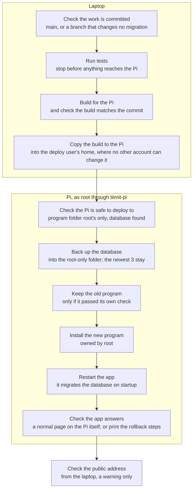

# Tiimit Deployment Guide

How Tiimit is deployed to a Raspberry Pi running Ubuntu Server, and what to do when a
deployment goes wrong.

## Overview

| Thing | Value |
|---|---|
| Binary | `/opt/tiimit/web` (owned by root) |
| Backups | `/var/backups/tiimit/` (root only) |
| Database | `/var/lib/tiimit/tiimit.db` (`tiimit` only) |
| Settings | `/etc/tiimit/tiimit.env` (root only), from [`deploy/tiimit.env.example`](../deploy/tiimit.env.example) |
| Service | systemd unit `tiimit.service` |
| Weekly backup | `tiimit-backup.timer`, Monday 04:00 Helsinki time |
| Process user | `tiimit` (system user, no login shell) |
| Listen address | `127.0.0.1:8080`, from `LISTEN_ADDRESS` in the settings |
| Target arch | `arm64` (Pi 3/4/5 running 64-bit Ubuntu; confirm with `uname -m`) |

### What ships inside the binary

A deploy copies **one file**. Everything the app needs at runtime is compiled into it:

- **Static assets:** `cmd/web/static/` via `//go:embed static` (`staticFiles` in [cmd/web/main.go](../cmd/web/main.go)).
  This includes `tailwind.css`, which `make prod/build-arm64` regenerates before compiling.
  There is no separate step to deploy CSS.
- **Database migrations:** `sql/schema/*.sql` via `//go:embed schema/*.sql`
  ([sql/migrations.go:5](../sql/migrations.go#L5)). They run automatically on every startup
  through goose (`db.RunMigrations`).
- **templ templates:** generated to `*_templ.go` at build time and compiled in.

Consequence worth remembering: **a deploy is also a migration.** The new binary migrates the
live database the moment systemd starts it. That is why every `make deploy` backs the database
up first.

## One-time server setup

These steps set up a fresh Pi, and also move a Pi that runs the old setup to the new one (milestone 04). **Do them in this order.** Each step leaves the site working, so you can stop between steps, but a different order can take the site down or lock you out of root. Pick a time when nobody is setting up a practice.


What each folder is for, and who may use it:

| Path | Owner, mode | Holds |
|---|---|---|
| `/opt/tiimit` | root, `755` | The program (`web`). Only root can change it. |
| `/var/lib/tiimit` | `tiimit`, `700` | The database. Only the app's own account can read it. |
| `/var/backups/tiimit` | root, `700` | Database backups. Only root can read or delete them. |
| `/etc/tiimit/tiimit.env` | root, `600` | The app's settings. Only root can read them; systemd reads them before it starts the app. |

### 0. Only on a fresh Pi: the app's account and folders

```bash
sudo useradd --system --no-create-home --shell /usr/sbin/nologin tiimit
sudo install -d -o root -g root -m 755 /opt/tiimit
sudo install -d -o tiimit -g tiimit -m 700 /var/lib/tiimit
```

`tiimit` has no home folder and no login shell. It exists only to run the app, and nobody can log in as it. Copy a program into `/opt/tiimit/web` by hand (`sudo install -o root -g root -m 755 web /opt/tiimit/web`), then skip the backup in step 2, since there is no database yet. Once the app runs, create the first user with [Recovering onto an empty database](#recovering-onto-an-empty-database).

### 1. A root shell in a second terminal

Open a second terminal, log in to the Pi, and run:

```bash
sudo -v   # asks for your password; it must work before you go on
sudo -i   # a root shell
```

Leave this root shell open until you have finished the last step and checked that `sudo` still works in a new terminal. If a later step breaks `sudo`, you fix it from here. Root has no SSH key, so without this shell a broken `sudo` means taking out the SD card.

### 2. A backup before changing anything

```bash
sudo install -d -o root -g root -m 700 /var/backups/tiimit /var/backups/tiimit/deploy /var/backups/tiimit/weekly
sudo -u tiimit sqlite3 /var/lib/tiimit/tiimit.db ".backup '/var/lib/tiimit/before-setup.db'"
sudo mv /var/lib/tiimit/before-setup.db /var/backups/tiimit/before-setup.db
sudo sqlite3 -readonly /var/backups/tiimit/before-setup.db "PRAGMA integrity_check; SELECT count(*) FROM players; SELECT count(*) FROM practices;"
```

The app's own account makes the copy with SQLite's backup, which is safe while the app runs; a plain file copy is not. Root then moves it where only root can reach it. The last line should print `ok` and two counts that match what the app shows.

### 3. File owners and permissions

```bash
# Nothing in these folders should be a link; this prints nothing when that is true.
sudo find /opt/tiimit /var/lib/tiimit -type l

# The program and its folder belong to root.
sudo chown -R root:root /opt/tiimit
sudo chmod 755 /opt/tiimit /opt/tiimit/web

# Only the app's own account can read the data.
sudo chown -R tiimit:tiimit /var/lib/tiimit
sudo chmod 700 /var/lib/tiimit
sudo chmod 600 /var/lib/tiimit/tiimit.db

sudo ls -la /opt/tiimit /var/lib/tiimit
```

If `find` prints anything, stop and look at it before going on: a link there could make root change a file somewhere else.

The app keeps running through this step. Check that the site still loads on your phone.

### 4. The settings file

On the laptop, from the repository:

```bash
scp deploy/tiimit.env.example deploy/tiimit.service <deploy-user>@<pi-address>:~
```

On the Pi:

```bash
sudo install -d -o root -g root -m 755 /etc/tiimit
sudo install -o root -g root -m 600 ~/tiimit.env.example /etc/tiimit/tiimit.env
sudo systemctl cat tiimit | grep POSTHOG_API_KEY   # the key the old unit used
sudo nano /etc/tiimit/tiimit.env                    # put that key after POSTHOG_API_KEY=
sudo ls -la /etc/tiimit/tiimit.env                  # -rw------- root root
rm ~/tiimit.env.example
```

Write the values without quotes. systemd and the app's `.env` reader treat quotes differently, so a quoted value can end up with the quotes in it.

### 5. The new unit

```bash
sudo cp /etc/systemd/system/tiimit.service ~/tiimit.service.old   # to put back if this step fails
sudo systemd-analyze security tiimit | tail -1                     # the score before

sudo install -o root -g root -m 644 ~/tiimit.service /etc/systemd/system/tiimit.service
sudo systemctl daemon-reload
sudo systemctl restart tiimit

systemctl is-active tiimit                       # active
sudo journalctl -u tiimit -n 20 --no-pager       # no errors
sudo systemd-analyze security tiimit | tail -1   # a lower (better) score than before
rm ~/tiimit.service
```

Then on the phone: log in, open a practice and tick a vest. That proves the app can still write its database with the tighter rules.

**If the app does not start**, put the old unit back from the root shell, then read the log to see why:

```bash
install -o root -g root -m 644 /home/<deploy-user>/tiimit.service.old /etc/systemd/system/tiimit.service
systemctl daemon-reload && systemctl restart tiimit
journalctl -u tiimit -n 50 --no-pager
```

When everything works, delete the old unit's copy, since it holds the PostHog key: `rm ~/tiimit.service.old`.

### 6. The deploy script and its sudo rule

On the laptop:

```bash
scp deploy/tiimit-pi deploy/sudoers <deploy-user>@<pi-address>:~
```

On the Pi:

```bash
sudo install -o root -g root -m 755 ~/tiimit-pi /usr/local/sbin/tiimit-pi

ls /etc/sudoers.d/                                  # the old rule's file
sudo cat /etc/sudoers.d/tiimit-deploy               # the old rule, replaced below
sed "s/^DEPLOY_USER /$USER /" ~/sudoers > ~/tiimit-deploy
sudo visudo -c -f ~/tiimit-deploy                   # parsed OK
sudo install -o root -g root -m 440 ~/tiimit-deploy /etc/sudoers.d/tiimit-deploy
sudo visudo -c                                      # every file parsed OK
rm ~/sudoers ~/tiimit-deploy ~/tiimit-pi
```

If the old rule was in a file with another name, delete that file too (`sudo rm /etc/sudoers.d/<old-name>`), then run `sudo visudo -c` again. Leave Roundtrip's file alone.

Check what the deploy user may now do:

```bash
sudo -k                                             # forget the password for this test
sudo -n -l /usr/local/sbin/tiimit-pi install        # prints the command: allowed without a password
sudo -n true                                        # "a password is required": nothing else is
sudo -v                                             # your password still works
```

If `sudo` stops working, fix `/etc/sudoers.d/tiimit-deploy` from the root shell with `visudo -f /etc/sudoers.d/tiimit-deploy`.

### 7. The first `make deploy`

On the laptop, copy [`deploy/deploy.conf.example`](../deploy/deploy.conf.example) to `deploy/deploy.conf` and fill it in (see [Deploying](#deploying)). Then:

```bash
make deploy                    # on main
ALLOW_BRANCH=1 make deploy     # or on a branch that changes no migration
```

It should end with `Deployed <commit>`, and the Pi's part should print the backup's name and the `Tiumo version` line. Then on the Pi:

```bash
sudo ls -l /opt/tiimit /var/backups/tiimit/deploy
```

`/opt/tiimit` now holds `web`, `web.previous` (the version from before) and `web.checked`, all owned by root, and the deploy folder holds one backup. On the phone, log in and tick a vest.

### 8. SSH with keys only

First prove the key works on its own, from the laptop. It must log in without asking for a password:

```bash
ssh -o PasswordAuthentication=no -o KbdInteractiveAuthentication=no <deploy-user>@<pi-address> true && echo key works
```

Then on the Pi:

```bash
printf 'PasswordAuthentication no\nKbdInteractiveAuthentication no\n' |
  sudo tee /etc/ssh/sshd_config.d/10-keys-only.conf
sudo sshd -t                                                       # prints nothing when valid
sudo sshd -T | grep -Ei '^(passwordauthentication|kbdinteractiveauthentication) '   # both "no"
sudo systemctl reload ssh
```

The file's name starts with `10-` so it sorts before Ubuntu's `50-cloud-init.conf`: for each setting, sshd uses the first value it reads, and `50-cloud-init.conf` turns passwords on.

Keep this SSH session open, and check from a new terminal on the laptop:

```bash
ssh -o PubkeyAuthentication=no <deploy-user>@<pi-address>   # "Permission denied (publickey)"
ssh <deploy-user>@<pi-address> true && echo key works
```

If the key login fails, delete `/etc/ssh/sshd_config.d/10-keys-only.conf` from the open session and run `sudo systemctl reload ssh`.

### 9. Clear out what is left over

On the Pi:

```bash
sudo rm -r /opt/tiimit/backup /opt/tiimit/cli     # the old program copies and the removed CLI
sudo rm -rf /opt/tiimit/player-files              # attendance reports with real names, if still there
rm -f ~/tiimit.service.old ~/tiimit-new
sudo ls -la /opt/tiimit                           # web, web.checked, web.previous
```

On the laptop, delete the old deploy's settings: `rm .deploy.conf`.

Last, open a new terminal, check `sudo -v` still takes your password, and only then close the root shell from step 1.

### 10. The weekly backup

A timer backs the database up every Monday at 04:00 Helsinki time, through the same root script as a deploy, into `/var/backups/tiimit/weekly`. The newest 3 stay. If the Pi is off at 04:00, the backup runs when it starts again.

The script gained the weekly backup in this step, so install it again. On the laptop:

```bash
scp deploy/tiimit-pi deploy/tiimit-backup.service deploy/tiimit-backup.timer <deploy-user>@<pi-address>:~
```

On the Pi:

```bash
sudo install -o root -g root -m 755 ~/tiimit-pi /usr/local/sbin/tiimit-pi
sudo install -o root -g root -m 644 ~/tiimit-backup.service ~/tiimit-backup.timer /etc/systemd/system/
rm ~/tiimit-pi ~/tiimit-backup.service ~/tiimit-backup.timer
sudo systemctl daemon-reload
sudo systemctl enable --now tiimit-backup.timer
systemctl list-timers tiimit-backup.timer           # NEXT: the coming Monday, 04:00
```

Then run one backup by hand and look at it:

```bash
sudo systemctl start tiimit-backup.service          # returns when the backup is done
sudo journalctl -t tiimit-pi -n 3 --no-pager        # "Backup: /var/backups/tiimit/weekly/..."
sudo ls -l /var/backups/tiimit/weekly
```

The timer runs the script as root, but the job may write only the app's data folder and the backup folder, and has no network ([`deploy/tiimit-backup.service`](../deploy/tiimit-backup.service)). The sudo rule does not allow `tiimit-pi backup weekly`, so the deploy user starts it with `sudo systemctl start`, which asks for the password.

## Deploying

A deploy is also a migration of the live database, so it backs the database up first. Deploy only when nobody is setting up a practice.

### Configuration

Copy [`deploy/deploy.conf.example`](../deploy/deploy.conf.example) to `deploy/deploy.conf` (gitignored) and fill in:

| Setting | What |
|---|---|
| `PI_USER` | The SSH login on the Pi |
| `PI_HOST` | The Pi's address on the home network |
| `PUBLIC_URL` | `https://tiumo.fi`, checked after the deploy as a warning only |

### Running it

```bash
make deploy                    # from a clean main
ALLOW_BRANCH=1 make deploy     # from a committed branch, to try a milestone on the phones
```

A branch is refused when it changes any migration file compared with `main`: a migration stays in the live database even if the branch changes or is dropped later. A new migration must also be dated after the newest one on `main`, or Goose refuses to start.

### What it does



The laptop part is [`deploy/deploy.sh`](../deploy/deploy.sh); the Pi part is [`deploy/tiimit-pi`](../deploy/tiimit-pi), the only command the deploy user may run as root without a password ([`deploy/sudoers`](../deploy/sudoers)). It takes no input from the laptop: every path is fixed in the script or read from the settings file.

When the deploy fails, its last lines name the step. Nothing reaches the Pi before the copy, and on the Pi nothing is installed before the backup succeeds.

**If the connection drops** during the Pi part, the Pi finishes the deploy on its own. See how it ended with `sudo journalctl -t tiimit-pi -n 20 --no-pager`: if it ends with `FAILED`, follow [Rollback](#rollback); otherwise run `make deploy` again.

## Verifying a deployment

`make deploy` checks the app itself. To look by hand, on the Pi:

```bash
systemctl is-active tiimit                                  # active
sudo journalctl -u tiimit -n 20 --no-pager | grep version   # the commit that runs
sudo journalctl -t tiimit-pi -n 20 --no-pager               # what the last deploy did
sudo ls -l /var/backups/tiimit/deploy                       # the newest 3 deploy backups
```

The weekly backup:

```bash
systemctl list-timers tiimit-backup.timer                   # LAST and NEXT run
systemctl status tiimit-backup.service                      # how the last run ended
sudo ls -l /var/backups/tiimit/weekly                       # the newest 3 weekly backups
```

## Rollback

The deploy prints these steps when the new version does not answer. On the Pi:

```bash
sudo journalctl -u tiimit -n 50 --no-pager          # why it failed
sudo systemctl stop tiimit
sudo install -o root -g root -m 755 /opt/tiimit/web.previous /opt/tiimit/web
sudo systemctl reset-failed tiimit
sudo systemctl start tiimit
```

`web.previous` is always a version that passed its check after its own deploy: a deploy after a failed one does not replace it.

**If the failed version added a database migration,** the database has already been migrated. An older program starts on a newer database without complaint, and may then misbehave, so put the database back too, before starting: use the deploy backup from just before the **first** failed deploy, chosen by the time in its name, with [Restoring a backup](#restoring-a-backup). Anything saved since that backup is lost. After a failed deploy, the deploy backups are not pruned, so that one is still there.

### Restoring a backup

This puts the database back as it was when a backup was taken: after a failed deploy that ran a migration (above), or after data was lost or broken. **Everything saved since that backup is lost,** and everyone has to log in again. A backup holds the logins and invitations of its own time, so the restore deletes every login and every invitation that was not used yet. Send new invitations afterwards to anyone who had one open. Do it when nobody is setting up a practice.

Run the steps one at a time in a root shell, and stop at the first one that does not give what its comment says. Nothing changes the live database before step 5, so until then `systemctl start tiimit` brings the site back as it was.

```bash
sudo -i
umask 077                                       # new files readable by their owner only

# 1. Pick the backup by the time in its name, and check it
ls -l /var/backups/tiimit/deploy /var/backups/tiimit/weekly
backup=/var/backups/tiimit/deploy/tiimit-YYYYMMDD-HHMMSS.db       # the one you picked
sqlite3 -init /dev/null -readonly "$backup" "PRAGMA integrity_check"   # ok

# 2. Stop the app
systemctl stop tiimit

# 3. Keep the data as it is now, in case the wrong backup was picked
runuser -u tiimit -- sqlite3 -init /dev/null -readonly -bail /var/lib/tiimit/tiimit.db ".backup /var/lib/tiimit/before-restore.db"

# 4. Hand the backup to the app's account
runuser -u tiimit -- sh -c 'cat > /var/lib/tiimit/restore.db' < "$backup"

# 5. Restore, and end every login and every unused invitation (prints ok)
runuser -u tiimit -- sqlite3 -init /dev/null -bail /var/lib/tiimit/tiimit.db \
  ".restore 'file:/var/lib/tiimit/restore.db?mode=ro'" \
  "DELETE FROM user_sessions;" \
  "DELETE FROM user_invites WHERE used_at IS NULL;" \
  "PRAGMA integrity_check;"
runuser -u tiimit -- rm /var/lib/tiimit/restore.db

# 6. Start the app and check it answers
systemctl start tiimit
curl -s -o /dev/null -w '%{http_code}\n' http://127.0.0.1:8080/      # 200
```

If this follows a [Rollback](#rollback), put `web.previous` back before step 6.

Why the steps look like this:

- **Everything in the data folder runs as the app's account** (`runuser -u tiimit`), so the database keeps its owner and root never follows a link the app could have put there. Root only reads the backup, from its own folder, in step 4.
- **SQLite's `.restore` writes the backup into the existing database file** instead of replacing the file, so its owner and permissions stay, and SQLite deals with its own journal file.
- **`?mode=ro` is a guard.** Without it, a missing `restore.db` would make SQLite restore a new, empty database over the live one.

Then check on a phone: it shows the login page, and after logging in the data is as it was at the backup's time. When it is right, delete the copy from step 3:

```bash
runuser -u tiimit -- rm /var/lib/tiimit/before-restore.db
exit                                            # leave the root shell
```

**If the wrong backup was restored,** stop the app and run step 5 with `before-restore.db` in place of `restore.db`, without the `rm` after it. That puts back the data from just before the restore, though the logins and unused invitations deleted the first time stay deleted.

## Manual deployment

If `make deploy` is broken and you need to ship anyway, do what it does by hand. On the laptop:

```bash
make test prod/build-arm64
scp ./build/web <deploy-user>@<pi-address>:tiimit-new
```

On the Pi, the root script does the rest, with the same backup and check:

```bash
sudo -n /usr/local/sbin/tiimit-pi install
```

## Troubleshooting

### `sudo: a password is required` during a deploy

**Cause.** The command the deploy runs on the Pi does not match the rule in `/etc/sudoers.d/tiimit-deploy`, so `sudo -n` refuses instead of asking for a password. sudo matches the whole command line, so the rule and the `sudo -n` line in [`deploy/deploy.sh`](../deploy/deploy.sh) must stay the same, and the script must be at `/usr/local/sbin/tiimit-pi`.

**Check**, on the Pi:

```bash
sudo -n -l /usr/local/sbin/tiimit-pi install    # prints the command if allowed
sudo cat /etc/sudoers.d/tiimit-deploy
```

Fix the rule as in setup step 6.

### Service won't start after a deploy

```bash
sudo journalctl -u tiimit -n 100          # the actual error is almost always here
ls -l /opt/tiimit/web                     # right timestamp? executable? owned by root?
sudo systemd-analyze verify tiimit.service
sudo systemctl show tiimit | grep Environment
```

Run the binary by hand as the service user to separate app problems from systemd problems:

```bash
sudo -u tiimit DB_PATH=/var/lib/tiimit/tiimit.db /opt/tiimit/web
```

### Database permission problems

```bash
sudo ls -la /var/lib/tiimit/
```

The folder must be `tiimit:tiimit` with mode `700`, and `tiimit.db` (plus a `tiimit.db-journal` if one is there) `tiimit:tiimit` with mode `600`. Fix them as in setup step 3.

### Reset the database

Destroys all data. For development and testing only:

```bash
sudo systemctl stop tiimit
sudo rm -f /var/lib/tiimit/tiimit.db*
sudo systemctl start tiimit    # migrations recreate the schema
```

After a reset nobody can log in; create the first user as below.

### Recovering onto an empty database

On a database with no users, Tiumo creates the first user on startup from
`FIRST_USER_USERNAME` and `FIRST_USER_PASSWORD`. Both must be set, and they
must follow the sign-up rules (username 5 to 20 letters a to z, å, ä, ö;
password 10 to 64 characters and not the username), or Tiumo stops and
the log names the setting to fix. On a database that has users, the two
settings are ignored.

1. Add both to the settings file, which only root can read:

   ```bash
   sudo nano /etc/tiimit/tiimit.env
   ```

   Write the values without quotes, and pick a password without quotes,
   backslashes or spaces at its ends, which systemd would change.
2. Restart and check the log says `Created the first user`:

   ```bash
   sudo systemctl restart tiimit
   sudo journalctl -u tiimit -n 20 --no-pager
   ```

3. Log in, then delete both lines from `/etc/tiimit/tiimit.env` and restart
   again, so the password does not stay on the Pi.

## Monitoring

```bash
systemctl is-active tiimit                # active | inactive | failed
systemctl status tiimit                   # CPU/memory, recent log lines
sudo du -h /var/lib/tiimit/tiimit.db      # database size
sudo du -sh /var/backups/tiimit           # backups: the newest 3 of each kind
sudo journalctl -u tiimit -f              # follow logs
```

## Known gaps

What the old guide listed as gaps, and where each one stands. Milestone 04 closed most of them; new ideas go in [`spec/product-notes.md`](../spec/product-notes.md).

| Gap | Now |
|---|---|
| The deploy did not stop on errors, and the tests did not run first | Done before milestone 04 |
| The program was installed as the deploy user's, with a wildcard sudo rule and timestamped copies piling up | Done in milestone 04: one root script, one sudo rule, one `web.previous` |
| Nothing checked the app after a restart | Done: the Pi checks for a normal page. Rolling back stays manual on purpose |
| No database backup before a deploy | Done: a backup before every deploy |
| The sudo rule was not in the repository | Done: [`deploy/sudoers`](../deploy/sudoers) |
| The listen address and environment were hardcoded | Done: read from the settings file |
| Nothing named the running version | Done: the log names the commit |
| No scheduled backups, no tested restore | Mostly done: a weekly backup on Monday 04:00, and the [restore steps](#restoring-a-backup), rehearsed on the laptop. The rehearsal on the Pi is I34 in `spec/product-notes.md` |
| `failed to load .env file` is logged on every start | Open: it trains you to ignore startup errors |

## Reference

- [systemd.service(5)](https://www.freedesktop.org/software/systemd/man/systemd.service.html)
- [sudoers(5)](https://www.sudo.ws/docs/man/sudoers.man/): command matching, `sudoers.d` naming rules
- [systemd.timer(5)](https://www.freedesktop.org/software/systemd/man/systemd.timer.html): `OnCalendar=`, `Persistent=`
- [SQLite command-line shell](https://sqlite.org/cli.html): `.backup` and `.restore`
- [Go cross-compilation](https://go.dev/doc/install/source#environment)
- [goose](https://github.com/pressly/goose): migrations
- [modernc.org/sqlite](https://pkg.go.dev/modernc.org/sqlite): the pure-Go SQLite driver this project uses (no cgo)

## Server information

Kept out of the repo. Record locally: hostname, IP, OS version, `uname -m` output, SSH user and
port.

## Changelog

| Date | Change |
|---|---|
| 2026-08-15 | Guide rewritten against actual behaviour; added sudoers setup, two incident write-ups, improvement backlog |
| 2026-11-28 | Milestone 04: setup steps for a safer Pi, `make deploy` with a backup and a check, the old incident write-ups and backlog replaced |
| 2026-11-28 | Milestone 04: the weekly backup (setup step 10) and the restore steps |
